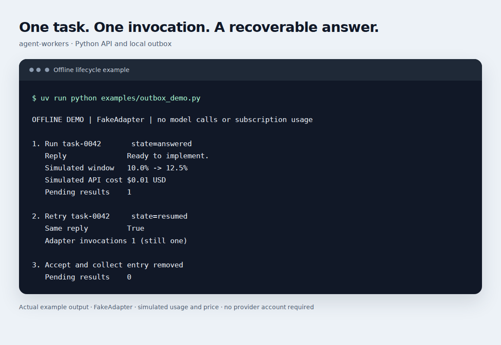
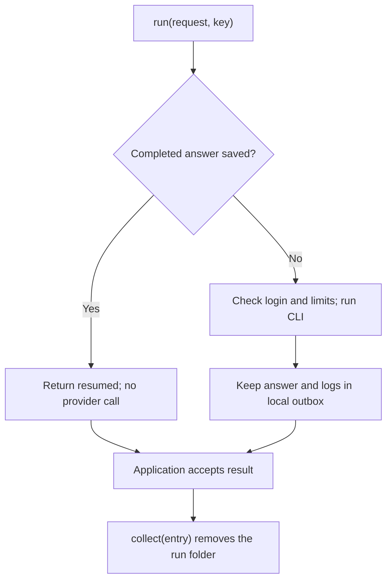

# agent-workers

**Run a subscription CLI as a Python worker, and keep completed answers until they are accepted.**

agent-workers wraps **Claude Code** and **Codex** behind the same Python interface. Each worker uses one account directory, runs one request per call, measures subscription usage before and after the turn, and reports token usage and an equivalent API cost estimate.

A task key connects the turn to a persistent local outbox. If delivery fails after the model has answered, retrying the same key returns the saved answer without another model call.

[Quick start](#quick-start) · [Python API](#use-it-in-python) · [How recovery works](#how-recovery-works) · [Full English guide](agent_workers/README.md) · [Русская инструкция](README.ru.md)

## What it provides

| Capability | Behavior |
| --- | --- |
| One interface for two providers | Use Claude Code or Codex through the CLI or Python API. |
| Account management | Sign in, check the connection and subscription usage, or sign out. |
| Turn supervision | Stop on request, enforce total/inactivity timeouts, and clean up the CLI process group on Linux. |
| Subscription-aware execution | Check applicable usage windows before a new turn; optionally allow provider credits. |
| Usage reporting | Normalized token counts, before/after measurements, window deltas, and an API cost estimate. |
| Recoverable answers | Keep the result until `collect()`; reuse completed answers when the same task key returns. |

The package has **no Python runtime dependencies** beyond the standard library. Live turns require the provider's CLI and a supported subscription account. Your application owns the queue, task leases, retries, result delivery, and long-term history.

## See it work without an account

The bundled example runs the real worker and outbox using `FakeAdapter`, which launches a Python subprocess instead of a provider CLI. Usage and price figures are simulated; no model is called.

```bash
git clone https://github.com/RusselSand/agent-workers.git
cd agent-workers
uv sync
uv run python examples/outbox_demo.py
```



The [example source](examples/outbox_demo.py) includes assertions for the recovery behavior. [Capture instructions and transcript](docs/screenshots/README.md) are included.

## Quick start

### 1. Install the package and a provider CLI

Requires **Python 3.14+**, Git, and [uv](https://docs.astral.sh/uv/getting-started/installation/). `uv` can download the required Python version. For production, use Linux, usually in Docker; Windows supports development with the limitations described in the [English guide](agent_workers/README.md#platforms-and-docker).

In an existing uv project, add:

```toml
[project]
dependencies = ["agent-workers"]

[tool.uv.sources]
agent-workers = { git = "https://github.com/RusselSand/agent-workers", tag = "v0.4.0" }
```

Then run `uv sync`. The repository is public; no GitHub token or invitation is required. Pin a release tag and update it deliberately.

Install the CLI for the provider you use, with Node.js/npm as required by that CLI:

```bash
npm install -g @anthropic-ai/claude-code
```

Or:

```bash
npm install -g @openai/codex
```

Provider output formats matter to the adapters. Pin the CLI version you have verified in your deployment instead of silently upgrading it in a production image.

### 2. Configure one connection

Create `.env` in your project, using the [English example](agent_workers/.env.example):

```dotenv
AGENT_PROVIDER=claude
AGENT_HOME=../agent-accounts/claude
AGENT_REFUSE_ABOVE=95
AGENT_TIMEOUT=3600
AGENT_IDLE_TIMEOUT=900
```

For Codex, set `AGENT_PROVIDER=codex` and choose a separate account directory. `AGENT_MODEL` and `AGENT_EFFORT` are optional. Keep the account directory outside your repository: it contains login credentials and run data.

Settings precedence is **command flags → environment variables → `.env` → defaults**. Relative paths in `.env` resolve from that file's directory. [All settings](agent_workers/README.md#configuration) are documented in English.

### 3. Sign in and make a turn

```bash
uv run python -m agent_workers login
uv run python -m agent_workers status
uv run python -m agent_workers run "Reply with one word: ready"
```

Login is interactive; use the provider's subscription sign-in flow. Each command identifies the account directory it uses. CLI help and diagnostic messages currently use Russian; command names, flags, and Python field names are as shown here.

To inspect a request without starting a provider process:

```bash
uv run python -m agent_workers run --dry-run "Reply with one word: ready"
```

A manual CLI `run` creates a fresh task key every time and collects a successfully printed answer immediately. Use the Python API with a stable key for delivery recovery.

## Use it in Python

```python
from agent_workers import build

worker = build()  # Reads your connection settings.
result = worker.run(
    {"user": "List the acceptance criteria for an offline request queue."},
    key="task-0042",
    ensure_login=True,
)

if result["state"] in {"answered", "resumed"}:
    print(result["reply"].text)
    # Persist/accept the result in your application before removing the outbox entry.
    # worker.collect(result["entry"])
```

Use the same key when retrying the same task. Reusing a key for different input returns the original completed result; the key identifies a task, not a prompt hash. After `collect()`, that saved answer is gone, so another call with the same key starts a new turn.

A request can include `system`, `model`, and a `workspace` directory. With a workspace, the adapters enable read-only repository inspection. This does not isolate the rest of the filesystem: use trusted directories or an isolated container. [Request fields, results, and coordinator integration](agent_workers/README.md#python-integration) are covered in the English guide.

## How recovery works



The diagram shows the successful path. A live lock on the same key returns `in_progress`; exhausted limits return `limit_reached` before the turn starts; an interrupted attempt returns `incomplete`. A later retry of an incomplete attempt may start another paid turn, so your coordinator decides whether to retry.

Delivery is **at least once**: your receiver must accept duplicate results idempotently. Keep its task lease alive for the entire `run()` call, including login checks and usage measurements. Outbox locks work on one machine, not across hosts sharing a network drive.

## Understand the measurements

`result["tokens"]` separates fresh input, cached input, cache writes, and output. `result["before"]` and `result["after"]` describe subscription windows; `result["spent"]` contains their measured differences.

`result["cost"]` estimates what the same turn would cost through an API. It is **not an additional bill** for the subscription turn. Claude can report its own cost; Codex uses the adapter's model pricing table. Unknown prices return `None`. Window percentages can be rounded, so a short turn may show a zero delta.

## Development

```bash
uv sync
uv run python examples/outbox_demo.py
uv run ruff check .
uv run pytest
```

Tests use saved CLI samples and subprocess fakes, without provider logins or model calls. `agent_workers.testing` exposes `FakeAdapter`, `QUIET`, and `limits()` for applications built on this package.

| Location | Contents |
| --- | --- |
| [`agent_workers/README.md`](agent_workers/README.md) | Complete English configuration and integration guide. |
| [`agent_workers/base/`](agent_workers/base/) | Provider-independent process supervision, limits policy, pricing arithmetic, and outbox. |
| [`agent_workers/providers/`](agent_workers/providers/) | Claude Code and Codex commands, parsers, usage probes, and prices. |
| [`examples/outbox_demo.py`](examples/outbox_demo.py) | Runnable offline demonstration. |
| [`tests/`](tests/) | Contract, provider parsing, process, configuration, and outbox tests. |

Changes land through pull requests and release tags. Applications pick up a release by updating the pinned tag in `pyproject.toml` and running `uv lock`; incompatible API changes require a new major version.
